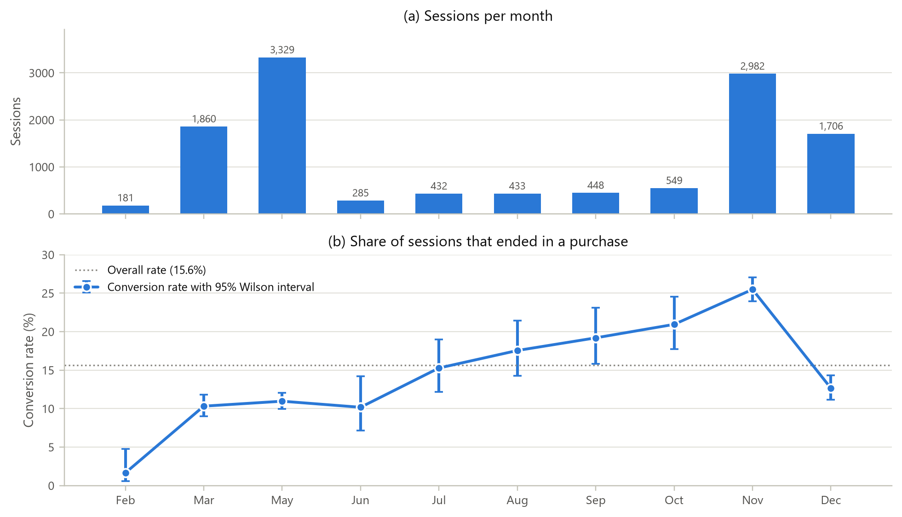
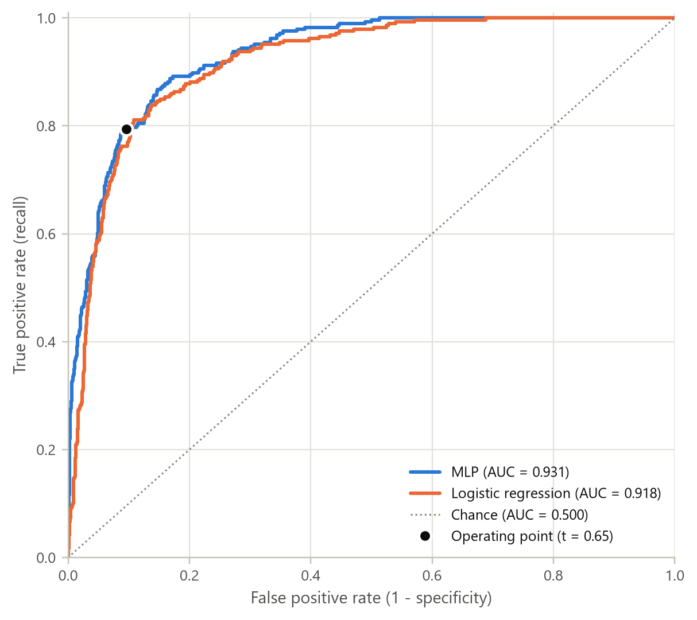
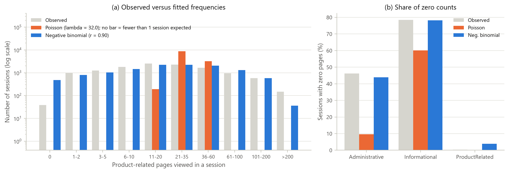
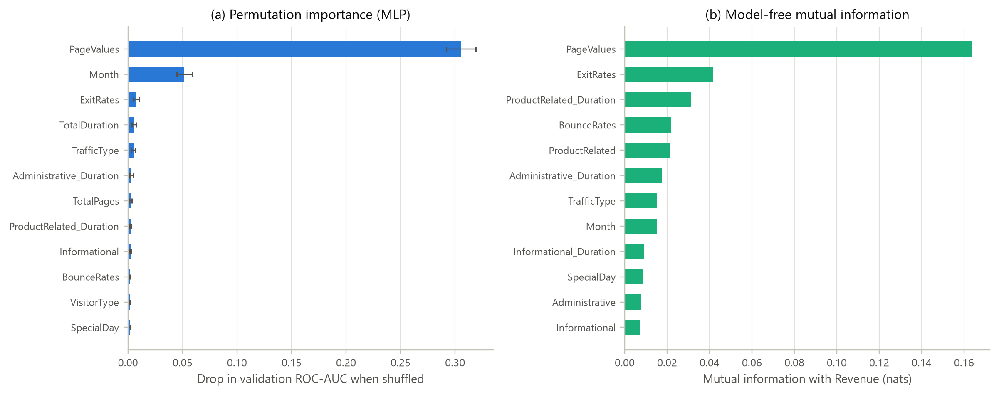

# From Clicks to Conversions

**Exploratory Data Analysis and MLP-Based Prediction of Online Shoppers' Purchasing Intention**

Nakul T (24AD068), III Year B.Tech. Artificial Intelligence and Data Science, KPR Institute of Engineering and Technology
U21ADP05 Exploratory Data Analysis and Visualization: Assignment II (Case Study)

---

## Overview

Only about one online shopping session in six ends in a purchase. This project studies 12,330 real browsing sessions to find out
which behaviours separate buyers from browsers, describes every variable with suitable probability distributions,
and trains a deep learning model (a multilayer perceptron) that predicts purchase intent from session behaviour.

The analysis follows Ben Fry's seven stages of visualization: **acquire, parse, filter, mine, represent, refine, interact**.

## Dataset

| Item | Details |
|---|---|
| Name | Online Shoppers Purchasing Intention Dataset |
| Source | UCI Machine Learning Repository, dataset 468, [doi:10.24432/C5F88Q](https://doi.org/10.24432/C5F88Q) |
| Licence | CC BY 4.0 |
| Size | 12,330 sessions x 18 fields (10 numerical, 7 categorical, binary target `Revenue`) |
| Local copy | [`data/online_shoppers_intention.csv`](data/online_shoppers_intention.csv) |

## Repository structure

```
online-shoppers-eda-mlp/
|-- README.md
|-- requirements.txt
|-- data/online_shoppers_intention.csv
|-- notebooks/shoppers_eda_mlp.ipynb      executed notebook with every output
|-- src/shoppers_eda_mlp.py               the same notebook as a script (jupytext pair)
|-- src/dashboard_template.html           template of the interactive dashboard
|-- dashboard/index.html                  self-contained interactive dashboard
|-- figures/                              25 figures used in the report
|-- results/                              results.json, CSV tables, best_mlp.keras
`-- report/                               case-study report (PDF and DOCX)
```

## How to run

```bash
pip install -r requirements.txt
jupyter nbconvert --to notebook --execute --inplace notebooks/shoppers_eda_mlp.ipynb
```

The full run takes about five minutes on a laptop CPU. Seeds are fixed and TensorFlow's deterministic operations are
enabled, so every number in the report reproduces exactly. Open `dashboard/index.html` in any browser to explore the data
interactively; it works offline. Add `?theme=light` or `?theme=dark` to the URL to force a colour theme.

## Key findings

* **Data quality:** no explicit missing values, but 125 duplicate bounce sessions (removed) and 1,078 structural
  zero durations, which are an analytics artefact and were kept.
* **Inequality:** the top 10% of sessions account for 45% of product-browsing time and 82% of page value (Gini 0.62 and 0.89).
* **Distributions:** page counts are over-dispersed (dispersion index 62), so a negative binomial fits far better than a
  Poisson. Browsing time follows a Weibull law with shape 0.81 (decreasing hazard).
* **Seasonality:** conversion ranges from 1.7% in February to 25.5% in November (chi-square = 376, p < 10^-74).
* **Drivers:** PageValues (Mann-Whitney AUC 0.86) and ExitRates dominate. New visitors convert more than returning
  visitors on weekdays, while returning visitors convert more at weekends.

## Model and results (test set, 1,831 sessions)

| Model | ROC-AUC | PR-AUC | Accuracy | F1 | Recall | Precision |
|---|---|---|---|---|---|---|
| **MLP (32 ReLU units, dropout 0.2), tuned threshold 0.65** | **0.931** | **0.740** | **0.887** | **0.687** | 0.794 | **0.605** |
| Logistic regression (balanced), tuned threshold 0.59 | 0.918 | 0.654 | 0.879 | 0.675 | **0.801** | 0.583 |

Twelve configurations were compared (hidden layers, dropout, learning rate); all reached a validation ROC-AUC between
0.932 and 0.934, so the smallest network was selected. Permutation importance confirms that PageValues, Month and ExitRates drive
the predictions.

| | |
|---|---|
|  |  |
|  |  |

## Report

The full case-study report is in [`report/`](report/) as both PDF and Word documents.

## Tested with

Python 3.13, NumPy 2.5, pandas 3.0, SciPy 1.18, scikit-learn 1.9, Matplotlib 3.11, TensorFlow 2.21, Keras 3.15.

## Acknowledgements

Dataset: C. O. Sakar and Y. Kastro, UCI Machine Learning Repository (CC BY 4.0). Original study: Sakar et al.,
*Neural Computing and Applications* 31, 6893-6908 (2019).
